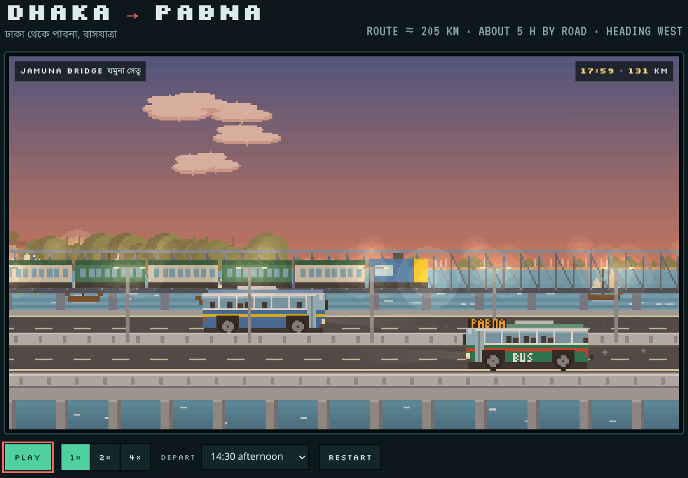

# Home Sweet Home Pabna

> Vibe-coded pixel-art bus ride across 205 km of Bangladesh — from the
> terminals of Dhaka, over the Jamuna Bridge, and on to Pabna.

**ঢাকা থেকে পাবনা, বাসযাত্রা** — a self-contained animation of a 5-hour coach trip, complete with sunrise, sunset, traffic,
rickshaws, cattle trucks, and a stop at Food Village.

---

## What you'll see

A 16:9 "screen" — styled like a tiny CRT cabinet — renders a procedurally
drawn coach rolling west along the Dhaka–Pabna highway. Around the bus:

- **Layered parallax scenery** — a far cityscape / tree line, a mid layer
  with houses, factories, and a ferris wheel, and a near road with
  vendors, rickshaws, cows, and goats.
- **A real sky** — the sun and moon arc through the day, the sky gradient
  shifts from pre-dawn blue to noon cyan to sunset orange to night black,
  and streetlights, headlights, and windows turn on when it gets dark.
- **A working traffic system** — trucks, microbuses, CNGs, cars, bikes,
  cattle carriers, and a lead cattle-truck + micro that move with the
  bus and react to speed changes.
- **Named landmarks** — the National Martyrs' Memorial silhouette,
  Nandan Park with its ferris wheel, the Elenga fuel station, the Jamuna
  Bridge toll plaza, the railway bridge with a crossing train, the
  Hatikumrul flyover, the Food Village complex, and the Pabna Bus
  Terminal.
- **A "facts" panel** that updates live as you pass each stop, plus a
  full "all stops" grid and a list of source links.

The whole trip is ~205 km and ~5.4 hours of simulated time, played back
at whatever speed you choose (1×, 2×, 4×).

---

## Credits

- Vibed and stitched together by **Sonnet 5.5** in a single sitting.
- Hand-tuned by [Ahsan Haris Ahmed](https://github.com/harisahmed05), who wanted to animate the bus journey without leaving the
  house.

## Licence

MIT. Do what you like with it — fork it for your own hometown route,
port it to a different country, or just enjoy the ride.
